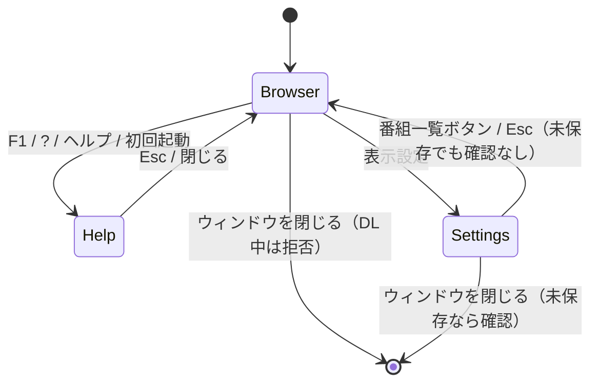

# GUI レビュー: 機能・画面レイアウト・画面遷移（2026-11-08）

対象: `src/nhk_radio/gui/`（build.py, browser.py, program_view.py, episode_view.py, activity_view.py, settings_view.py, download_panel.py, listing/*.py, styling.py）

## 1. 画面構成の現状

```
┌ ヘッダー: ロゴ / タイトル          [ヘルプ][キャッシュを全削除][表示設定] ┐
├──────────────┬───────────────────────────────────────┤
│ 番組一覧     │ ヒーロー: 番組名 / メタ / 統計  [一覧を取得][選択をDL]│
│ ジャンル選択 │ エピソード一覧: 絞り込み[クリア][保存済みのみ]        │
│ 検索(履歴)   │ (エラーバナー)                                        │
│ Tree(No/日/名)│ Tree(DL/放送日時/長さ/タイトル)                      │
│              ├───────────────────────────────────────┤
│              │ アクティビティ（DL ジョブ行 + 中止/削除）            │
├──────────────┴───────────────────────────────────────┤
│ ステータス                         ショートカットヒント               │
│ 選択セル: [meta][readonly entry][セル値をコピー]                        │
└───────────────────────────────────────────────┘
```

画面は「番組ブラウザ」と「表示設定」の 2 つを `grid_remove` で切り替え。ヘルプはモードレス Toplevel、右クリックメニュー・確認ダイアログは messagebox。



## 2. 指摘事項（重要度順）

### 高: 誤操作・誤ダウンロードにつながるもの

| # | 内容 | 根拠 |
|---|---|---|
| H1 | **番組を切り替えてもエピソード一覧は前の番組のまま**。ヒーローは新しい番組 B を表示するが、一覧・DL ボタン・`D` キーは表示中の番組 A に対して動く。B の見出しの下にある「選択エピソードをダウンロード」を押すと A のエピソードが落ちる | `listing/programs.py` `_on_program_select` はヒーローだけ更新。`download_panel.py` `_start_download_selected` は `displayed_program` を使う |
| H2 | 番組選択時のヒーロー統計が「詳細を読み込み中...」になるが、実際には何も読み込まない（取得は F / ダブルクリック / Enter / ボタン待ち）。H1 と合わせて状態が分かりにくい | `programs.py:133` |
| H3 | エピソード行の **ダブルクリック・Enter で即ダウンロード**（未保存なら確認なし）。一覧を開いた直後は先頭行が自動選択されるので、Enter 1 回で先頭回の DL が始まる | `episode_view.py` のバインド、`render_rows` の `selected_ids = ["episode-0"]` |
| H4 | 絞り込みで選択中の行が隠れると、**選択が先頭行へ黙って移る**。その状態で `D` を押すと意図しない回を DL する | `episode_view.py` `render_rows`（preserved が空なら episode-0） |
| H5 | 「キャッシュを全削除」がヘッダーの目立つ位置にあり、**確認ダイアログなし**で実行される | `download_panel.py` `_clear_cache` |

### 中: 画面遷移・状態管理の不整合

| # | 内容 | 根拠 |
|---|---|---|
| M1 | 設定画面から「番組一覧」/ Esc で戻るとき、未保存の変更はそのまま画面に適用されたまま残り、確認がない。その後ブラウザ画面からウィンドウを閉じても確認されず（`current_screen == "settings"` の時だけ確認）、**黙って破棄**される。終了時の確認条件が画面に依存していて一貫しない | `browser.py` `_cancel`、`_handle_escape` |
| M2 | 設定ボタンのラベルが二重定義。`_show_screen` が「ブラウザに戻る」を設定した直後に `_update_settings_ui` が「番組一覧」で上書きするため、前者は使われないコード | `browser.py:212`、`styling.py:131` |
| M3 | ヘルプを開いたままメインウィンドウを閉じると、ヘルプだけ閉じてアプリは終了しない（閉じるボタンが 2 回必要） | `browser.py` `_cancel` 冒頭 |
| M4 | DL 実行中は終了が完全に拒否される。「すべて中止して終了」の選択肢がなく、`_on_cancel_all` は UI から呼ばれていない | `browser.py:387`、`download_panel.py:122` |
| M5 | 「取得を中止」表示（`allow_cancel=True`）はどこからも使われず、一覧取得はキャンセルできない | `download_panel.py` `_set_loading` |
| M6 | キャッシュ削除後も表示中のエピソード一覧・ヒーローがそのまま残り、表示とデータがずれる | `browser.py` `_reset_ui_state_after_cache_clear` |
| M7 | 一覧取得成功時に `status_var.set("")` でステータスを消すため、直前の操作結果（DL 完了など）も消える | `download_panel.py:228` |

### 中: 機能の不具合・取りこぼし

| # | 内容 | 根拠 |
|---|---|---|
| F1 | **番組一覧のセルクリックで選択セル欄が更新されない（バグ）**。`_tree_cell_from_event` は `"#3"` 形式の列 ID を返すのに、`col == "title"` と比べている | `listing/programs.py:231` |
| F2 | 右クリックメニューの「再度ダウンロード」は未保存の行でも有効で、名前と動作が合わない（実際は通常の DL） | `operations.py:98` |
| F3 | 「保存済みのみ」フィルタ中にファイルを削除しても行が一覧に残る（`_refresh_downloaded_column` は ☑ を更新するだけで再フィルタしない） | `operations.py` `_delete_episode_file` |
| F4 | アクティビティの完了・失敗行は 1 行ずつ「削除」するしかない。一括クリアがなく、失敗理由の表示や再試行ボタンもない | `activity_view.py` `finish` |
| F5 | ジャンル Combobox（readonly）は `_is_text_input_focus` の対象外のため、フォーカス中に `F`/`D` を押すと取得や DL が始まる | `browser.py` `_is_text_input_focus` |

### 低: レイアウト・表示

| # | 内容 |
|---|---|
| L1 | エピソードのタイトル列すべてに `(ジャンル)` が付く。同じ番組内では全行同じ値なので情報にならず、列幅を使うだけ（`episode_view.py` `render_rows`） |
| L2 | 下部の「選択セル」欄（meta + entry + コピーボタン）が常に場所を取る。使う場面が限られ、通常は disabled。Ctrl/Cmd+C やツールチップで十分 |
| L3 | 設定画面のプレビューが 2 か所ある（文字サイズグループ内と下部「プレビュー」）。設定は 2 項目しかないので、全画面切り替えよりダイアログか小さいパネルで足りる |
| L4 | 最小幅 1040px に対して、サイドバー 430px とエピソード列の初期幅合計 910px が収まらない。最小サイズ付近ではタイトル列が極端に狭くなる（`browser.py` minsize、各 `column(width=)`） |
| L5 | 「一覧を取得」ボタンは取得後も同じラベル。取得済みなら「再取得」と出すと状態が分かる |
| L6 | ステータスバーのショートカットヒントが固定文字列。Shift+? のヘルプが載っていない。ヘルプ本文と二重管理になっている |
| L7 | アクティビティパネルの高さが 140px 固定で始まり、ジョブが 2 件を超えるとすぐスクロールが必要 |

## 3. 推奨対応（優先順）

1. **H1/H2**: 番組を選んだら一覧を自動取得する（キャッシュがあれば即表示）。または番組を切り替えた時点でエピソード一覧と DL ボタンを無効化し、「一覧を取得してください」と表示する。表示中の番組をヒーローと一致させるのが本質。
2. **H3/H4**: ダブルクリック・Enter での即 DL をやめる（または件数付きの確認を出す）。一覧表示時の先頭行自動選択と、絞り込み時に先頭行へ移る処理をやめ、選択なしにする。
3. **H5**: キャッシュ全削除に確認を付け、ヘッダーから設定画面などへ移す。
4. **M1**: 設定画面を離れるときに未保存の変更があれば「保存 / 破棄 / キャンセル」を確認する。終了時の判定は `settings_dirty` だけで行う。
5. **F1**: `col == "#3"` に直す（または列名で比べる）。テストを追加する。
6. **M3/M4/M5**: 終了フローを整える（ヘルプが開いていても終了できる、DL 中は「中止して終了」を選べる）。使われていない `allow_cancel` と `_on_cancel_all` は、UI に出すか削除するか決める。
7. 残りの中・低優先度は順次対応する。

## 4. 良い点
- 重い処理（番組取得、エピソード取得、保存済み判定、キャッシュ削除）はすべて別スレッド + キューで処理していて、UI が固まらない。
- 保存済みの行で上書き確認をし、事前に unlink しないので、DL に失敗しても元ファイルが残る。
- 検索のデバウンス、チャンク単位での挿入、世代番号による古い結果の破棄など、一覧描画のパフォーマンス対策が揃っている。
- View クラス + Actions Protocol に分かれていて、レイアウトとロジックの境界がはっきりしている。

## 5. 対応状況（2026-11-08, ブランチ `fix/gui-review-2026-11-08`）

| # | 状態 | 対応内容 |
|---|---|---|
| H1/H2 | 対応済み | 番組選択時に、メモリ上のキャッシュがあれば一覧を表示し、なければ一覧を空にして DL を無効化する。取得中に別番組へ切り替えた場合、古い取得結果はキャッシュに入れるだけで表示は上書きしない |
| H3 | 対応済み | ダブルクリック / Enter での DL に件数付きの確認を追加。ボタンと `D` キーでは確認なし |
| H4 | 対応済み | 一覧表示時と、絞り込みで選択行が隠れたときに先頭行を自動選択しない |
| H5 | 対応済み | キャッシュ全削除に確認ダイアログを追加（ボタンの配置は変えていない） |
| M1 | 対応済み | 設定画面を離れるとき、未保存なら保存 / 破棄 / キャンセルを確認する。終了時の確認は表示中の画面に関係なく `settings_dirty` で判定する。保存後に破棄したとき、最後に保存した値へ戻すよう修正 |
| M3 | 対応済み | ヘルプなどのポップアップを閉じて、そのまま終了処理を続ける |
| M4 | 対応済み | DL 中は「すべて中止して終了」を確認し、ワーカーの後始末を最大 5 秒待ってから終了する |
| F1 | 対応済み | 列 ID `#3` と比べるよう修正 |
| M2 | 対応済み | `_show_screen` 内の使われないラベル設定を削除。ラベルは `_update_settings_ui` だけで決める |
| M5 | 対応済み | 使われていない `allow_cancel` 引数と「取得を中止」表示を削除（取得のキャンセル機能は追加していない） |
| M6 | 対応済み | キャッシュ削除後に、エピソード一覧・概要・取得ボタンのラベルをリセットする |
| M7 | 対応済み | 取得成功時は「「番組名」のエピソード一覧を表示しました (N 件)。」と表示する |
| F2 | 対応済み | 未保存の行では「ダウンロード」、保存済みの行では「再度ダウンロード」と表示する |
| F3 | 対応済み | 「保存済みのみ」表示中に削除したら絞り込みをやり直す |
| F4 | 対応済み | 「完了分をクリア」ボタンを追加。失敗・中断した行のボタンを「再試行」にした。yt-dlp の最後の ERROR 行（無ければ終了コード、タイムアウト、起動エラー）を失敗理由として行とステータスに表示 |
| F5 | 対応済み | ジャンル Combobox もテキスト入力扱いにする |
| L1 | 対応済み | タイトル列からジャンル表記を外す |
| L5 | 対応済み | 選択中の番組を取得済みなら「再取得」と表示する |
| L6 | 対応済み | ヒントに `?` を追加（`F1 / ?: ヘルプ`）。ヘルプ本文との二重管理は残っている |
| 追加 | 対応済み | キャッシュ全削除で番組一覧が空になったまま残る不具合。削除後に番組一覧を取り直すようにした |
| L4 | 対応済み | 伸縮するタイトル列の初期幅を縮小（エピソード 560→160px、番組 360→170px）。最小幅 1040px でも全列が一覧幅に収まり、残り幅はタイトル列が埋める |
| L7 | 対応済み | ジョブ行を 1 行（約 39px、従来約 71px）にまとめ、ボタン余白を詰めた。初回表示時に仕切りをジョブ 3 件分（右側ペインの 30% まで）に設定。1360x840 で約 2.5 件、従来は約 1 件 |
| L2, L3 | 未対応 | 画面構成の変更（選択セル欄の削除、設定画面のダイアログ化）で、方針を決める必要があるため見送り |

回帰テスト: `tests/test_gui_review_fixes.py`（41 件）。
